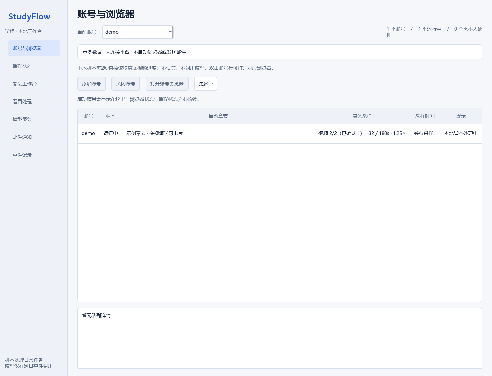
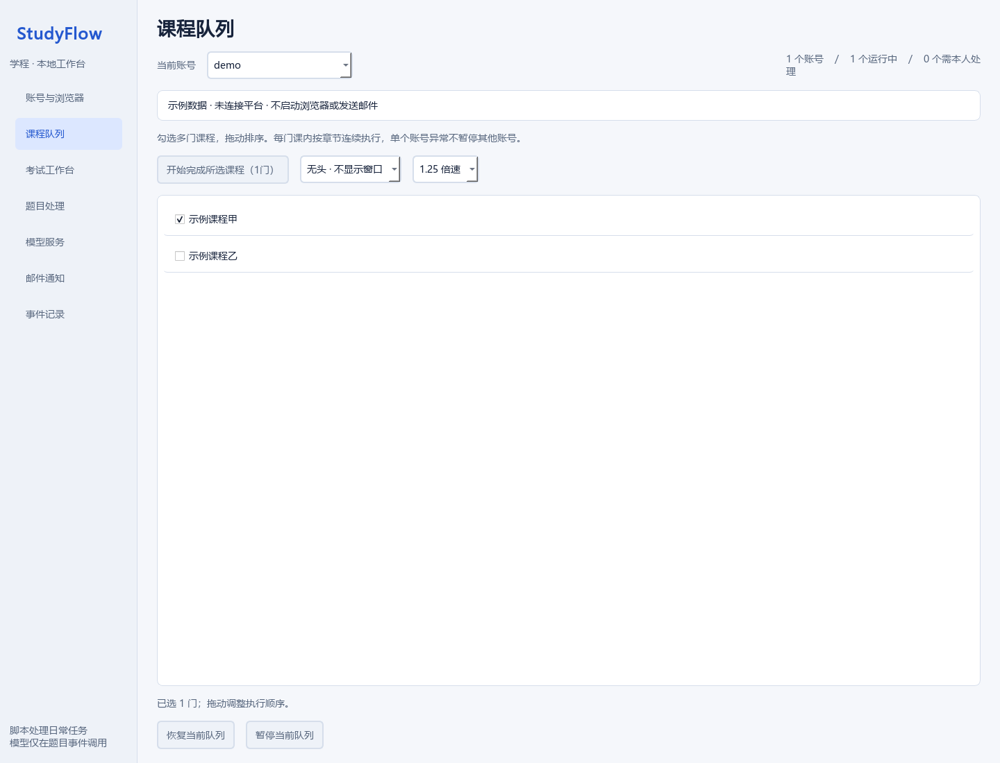
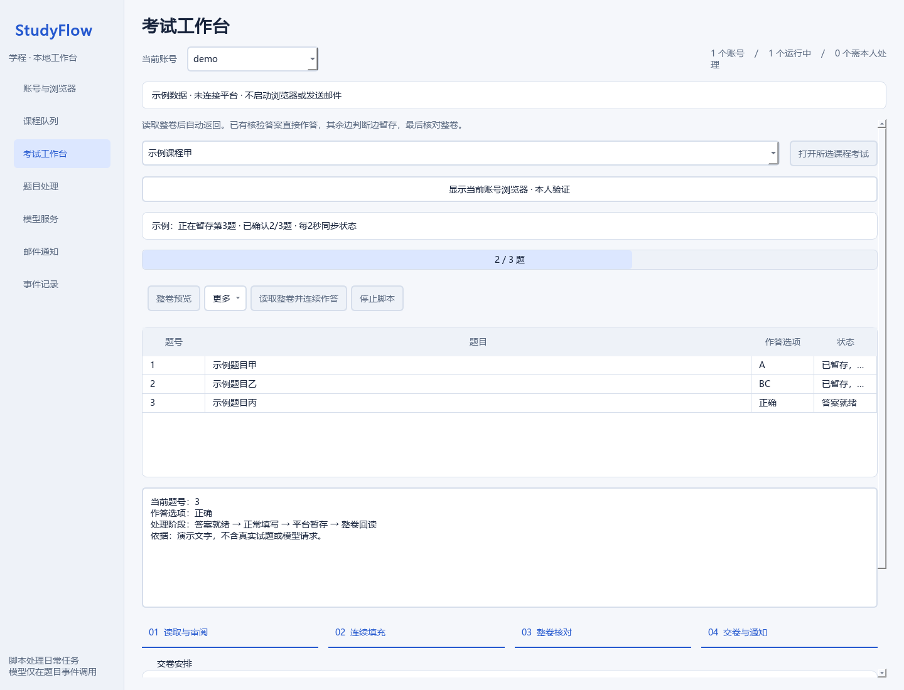
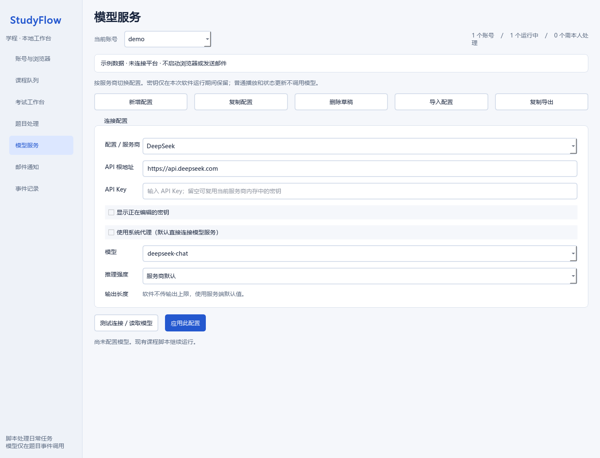
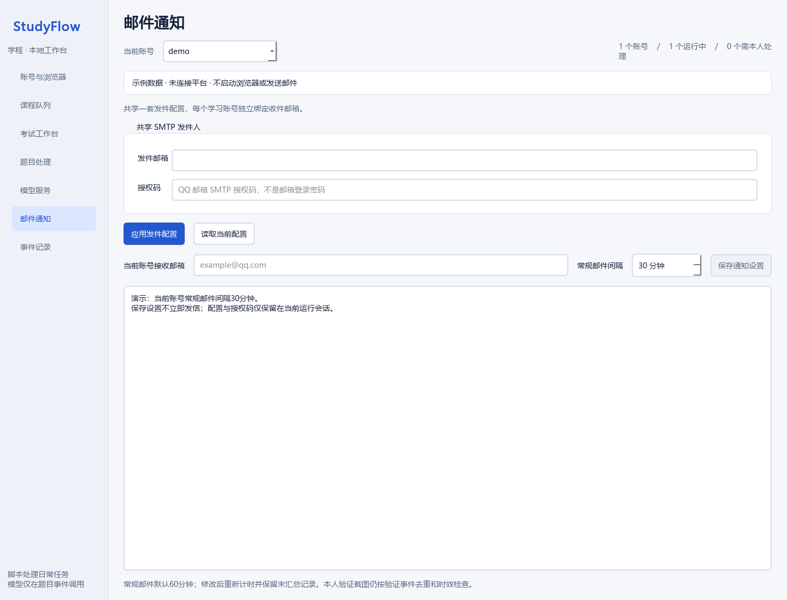

# StudyFlow 使用教程

> **仅供学习用途，严禁用于刷课。** 不得用于代学、代考、伪造学习记录或绕过本人验证。请遵守所在学校和平台规则。

## 1. 环境与安装

Windows便携包：从[Releases](https://github.com/2924547961/studyflow/releases/latest)下载并完整解压，双击 `StudyFlow.exe`。无需另装Python；使用本机Microsoft Edge。不要只复制exe文件而遗漏 `_internal` 目录。

源码安装建议Windows 10/11、Python 3.11及以上、Microsoft Edge，桌面使用PyQt6；源码字体解码需要Node.js LTS。便携包已使用所带的Node运行时。

在项目根目录执行：

```powershell
python -m venv .venv
.\.venv\Scripts\Activate.ps1
python -m pip install -e .
python -m pip install PyQt6 pytest pytest-asyncio
```

若浏览器配置使用 Playwright 自带 Chromium，可执行 `python -m playwright install chromium`；使用已安装的 Edge 时无需为此另装 Chromium。

## 2. 启动 MCP

在支持 MCP 的宿主中注册以下 stdio 服务，路径替换为实际位置：

```json
{
  "mcpServers": {
    "studyflow": {
      "command": "C:/path/to/studyflow/.venv/Scripts/python.exe",
      "args": ["-B", "-m", "chaoxing_learning_mcp"]
    }
  }
}
```

也可以在已激活虚拟环境的终端运行 `studyflow`。stdio 服务由 MCP 宿主启动时，不要把普通输出当作交互命令窗口使用。

## 3. 打开桌面

在同一个 MCP 服务上调用 `start_desktop_console`：

```json
{
  "app_path": "C:/path/to/studyflow/desktop/app.py",
  "python_path": "C:/path/to/studyflow/.venv/Scripts/python.exe"
}
```

通过 `start_desktop_console` 打开的桌面共享原MCP账号和浏览器。直接运行 `python desktop/app.py` 或便携程序，会自动启动独立的本地后端；账号和密钥需在该次会话录入，不能跨独立实例自动继承。`--preview-only` 用于明确的界面预览。

## 4. 账号和课程

1. 打开“账号与浏览器”，点击“添加账号”填写本人账号和密码。已有账号使用同一个“启动账号/关闭账号”按钮；有活动考试或待确认提交时会保留现场。
2. 登录后自动读取课程，在“课程队列”勾选本人需要查看的课程，并确认顺序。需要重新获取时使用“更多 → 更新课程”。
3. 点击“开始完成所选课程”。仅勾选课程不会启动任务。
4. 查看账号状态、当前章节、真实媒体采样和事件记录。人脸、滑块和账号验证由本人完成。

已完成标记以平台目录为准。未知数量、教师未发布的任务和验证等待不算完成。课程目录若与页面不一致，应刷新核验。

## 5. 试卷阅读与暂存

仅在课程和学校规则允许辅助工具时使用。当前功能支持平台试卷界面，但不保证兼容全部题型或平台版本。

1. 选择账号，课程自动出现在下拉框中，选择目标课程。
2. 点击“打开所选课程考试”，再点击“显示当前账号浏览器”。本人选择考试并处理平台验证。
3. 点击“整卷预览”，确认课程名、题量和试卷身份。
4. 如需先看审阅结果，使用“更多 → 仅审阅（不作答）”；此步骤本身不填写答案。若先点了审阅再进入考试或验证，工作台保留本次意图，识别到对应新标签页后自动接续。
5. 点击“读取整卷并连续作答”，整卷读取后自动返回；10题一组、最多3组并行由模型判断，仅不确定题联网复核。已确定题不因同组另一题失败而丢失。桌面每2秒同步真实暂存数量、题号、选项及依据。
6. 完成后核对整卷回读。回读一致仅表示保存内容一致，不表示答案全部正确。
7. 交卷可由本人操作；明确授权自动交卷时，整卷回读一致后按可见时间条件执行一次提交与确认。MCP的 `start_owned_exam_finish(authorized=true,submit_now=true)` 仅用于明确要求立即交卷的场景，仍核验试卷身份、过期及锁定状态。平台确认提交后再切换下一门，成绩未发布时保留待判分。

自动交卷默认关闭，默认时间阈值40分钟。作答过程中应避免手工切题、改选项或同时打开同账号的另一份活动试卷；已提交的旧标签页可保留。

## 6. 模型与通知

在“模型服务”选择服务商、Base URL 和可用模型，再应用设置。填写自己持有的 API 密钥；推理可能产生第三方费用。不要把密钥提交到仓库。

邮件通知为可选功能。配置 SMTP 服务器、端口、用户名和授权码，再为账号绑定接收邮箱。SMTP 接受邮件不等于已确认送达收件箱。

在“邮件通知”选择当前账号，将“通知间隔”设为1–1440分钟，点击“保存通知设置”；默认60分钟。修改间隔保留尚未汇总的记录和发送去重记录，不会立刻重复发信。本人验证截图仍按验证流程处理。

## 7. 常见情况

| 状态 | 处理方式 |
| --- | --- |
| 按钮处于处理中 | 等当前操作回执；同账号的预览、审阅和切课互斥 |
| 浏览器关闭 | 使用显示浏览器入口恢复；有未知提交时先核验原结果 |
| 保存结果待核验 | 先回读已保存结果，避免重复提交 |
| 已提交但暂无成绩 | 保留提交回执，等待平台发布成绩 |
| 教师未创建测验 | 保留未完成状态，等待教师发布 |
| 内容乱码或题型不支持 | 保留现场，查看日志；不按猜测的选项位置操作 |
| 界面显示运行但无新进度 | 查看真实采样时间与调度状态，不以旧状态判定正在学习 |

## 8. 测试

后端测试在项目根目录运行，桌面测试在 `desktop` 目录运行。隔离浏览器测试使用合成页面并拦截网络，不重复提交真实试卷。需设置 `STUDYFLOW_BROWSER_FIXTURE_TEST=1` 执行浏览器集成测试；双视频短片测试另需ffmpeg。

```powershell
python -m pytest tests
Set-Location desktop
python -m pytest
```

本文截图由真实桌面代码使用虚构 demo 数据渲染，不含真实账号、试题、密钥或学习成绩。










